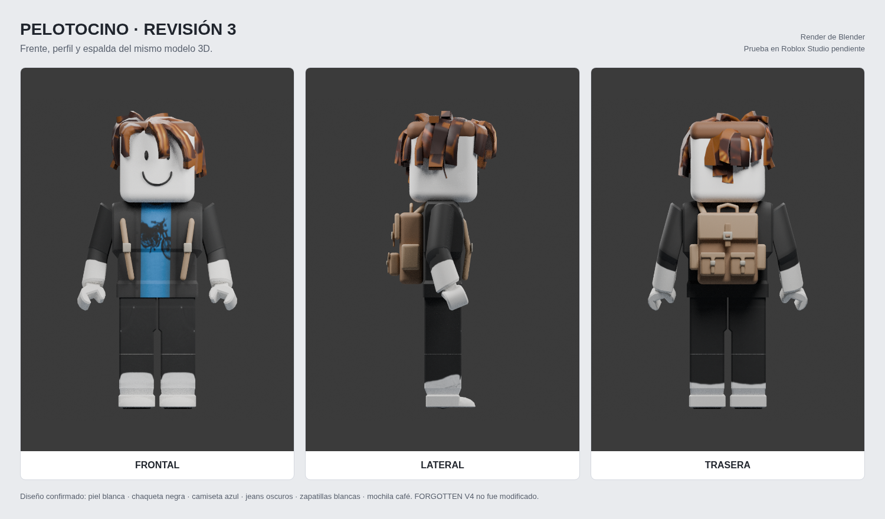

# Pelotocino — revisión 3 para evaluación

[Descargar ZIP completo](./Pelotocino-3D.zip?raw=true) · [Tres vistas](./Tres_vistas.png) · [Instrucciones y límites](./LEEME.md)

Nueva revisión con torso y piernas más largos, brazos más delgados, cabeza más compacta de bordes redondeados y ajuste del cabello castaño. Conserva la piel blanca, chaqueta negra, camiseta azul, jeans oscuros, zapatillas blancas y mochila marrón. El cuerpo utiliza 14 MeshParts R15 oficiales y 15 articulaciones Motor6D. No se afirma una semejanza exacta: la apariencia aún debe ser evaluada por el usuario.

Frente, lateral y espalda se renderizaron desde el mismo modelo de Blender. El ZIP incluye RBXM, RBXMX, BLEND, GLB, texturas, fuentes y verificaciones. La revisión se realizó en Blender; ForgeGUI no está conectado y no se utilizó.

Validado con Lune/rbx-dom y Blender. **Pendiente comprobar importación, física, apariencia de ropa y movimiento dentro de Roblox Studio.** El modelo nativo requiere acceso a los assets oficiales de Roblox. Blender/GLB incorporan geometría y texturas.

585 BaseParts; 24.310 vértices en la fuente. Los detalles nativos de cabeza, cara y mochila todavía usan primitivas; el cuerpo usa mallas y el GLB/Blender contienen geometría de malla. Falta medir rendimiento y optimizar accesorios para producción, además de integrar las habilidades reales del juego.

No se modificó FORGOTTEN V4 ni sus mapas. Probar primero en una Baseplate nueva.

