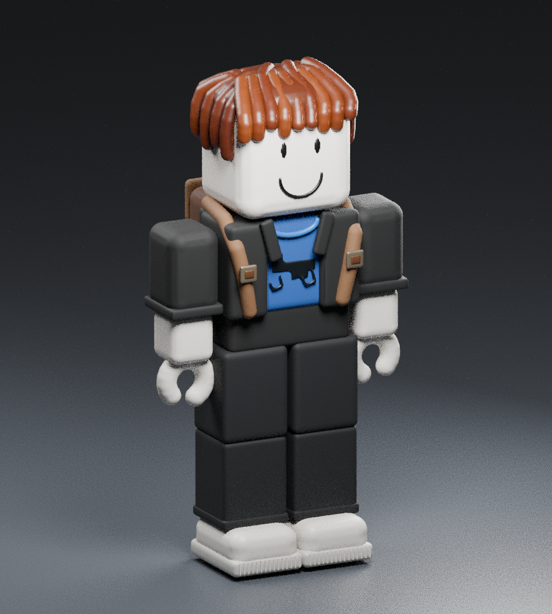

# Pelotocino-3D — entrega independiente para evaluación

[Descargar ZIP completo](./Pelotocino-3D.zip?raw=true) · [Instrucciones y límites](./LEEME.md)

El ZIP contiene la carpeta `Pelotocino-3D` con RBXM, RBXMX, BLEND, GLB, textura, fuentes, renders y verificaciones. Se incluyen también RBXM y RBXMX fuera del ZIP para insertarlos directamente.

La estructura R15 y el formato se comprobaron con rbx-dom/Lune; las animaciones de muestra cambian la pose en Blender. **No se ha probado en Roblox Studio.** Modelo para evaluación: 2.268 piezas nativas y geometría de intercambio densa; requiere optimización antes de producción. El dibujo de la camiseta es aproximado. Las habilidades específicas todavía requieren definición e integración.

Probar primero en una Baseplate nueva. No se han modificado FORGOTTEN V4, mapas ni archivos anteriores del repositorio.

