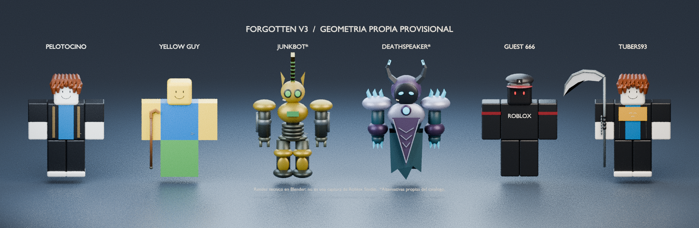
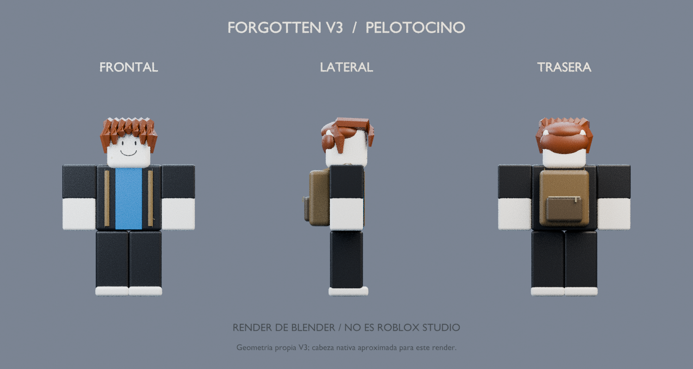
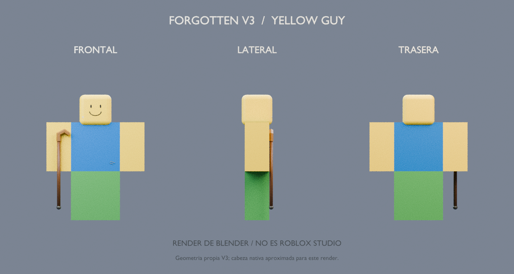
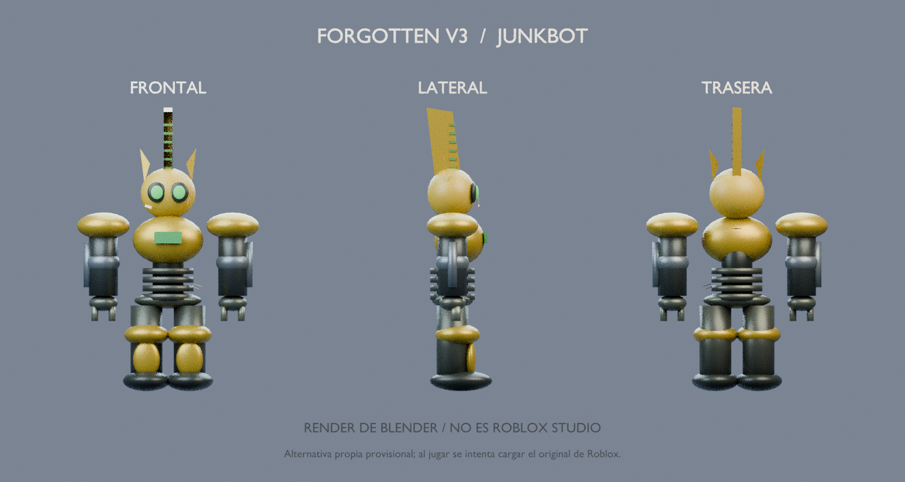
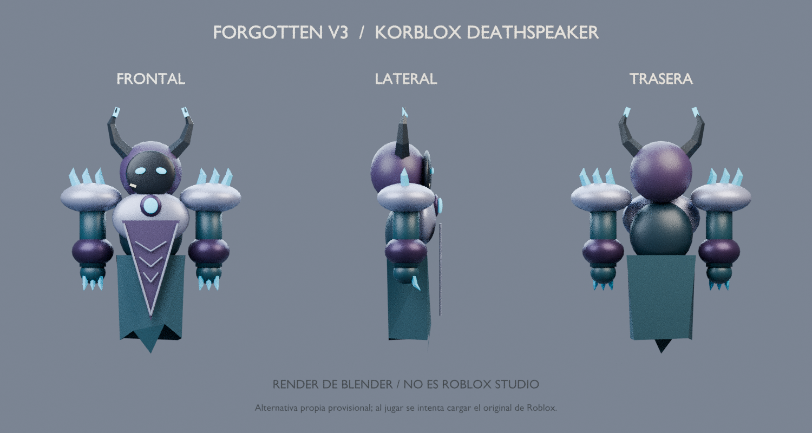
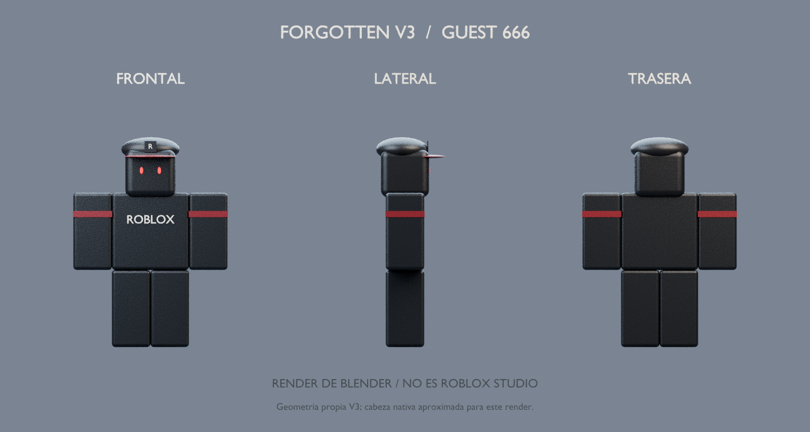
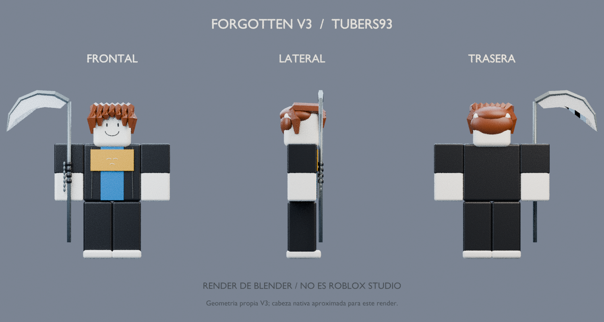

# Personajes V3: vistas para revisión

**Renders técnicos de Blender, no capturas de Roblox Studio.** Se generan desde `assets/v3/character-geometry.json`, fuente de las superficies propias usadas por el juego. Blender aproxima la cabeza nativa y su sombreado; la cara de autoría del render representa la sonrisa clásica que el juego toma del recurso integrado de Roblox.

Junkbot y Deathspeaker muestran alternativas propias provisionales. Al jugar se intenta cargar sus originales. El cabello Bacon también puede sustituirse por Pal Hair oficial. Estas imágenes no verifican el catálogo ni Studio.

## Pelotocino

## Yellow Guy

## Junkbot — alternativa propia

## Korblox Deathspeaker — alternativa propia

## Guest 666

## Tubers93

Regeneración: `blender -b -t 4 --python tools/render_v3_characters.py`. La escena local es `dist/v3/previews/Personajes-V3.blend`; el ZIP incluye imágenes y generador reproducible.
