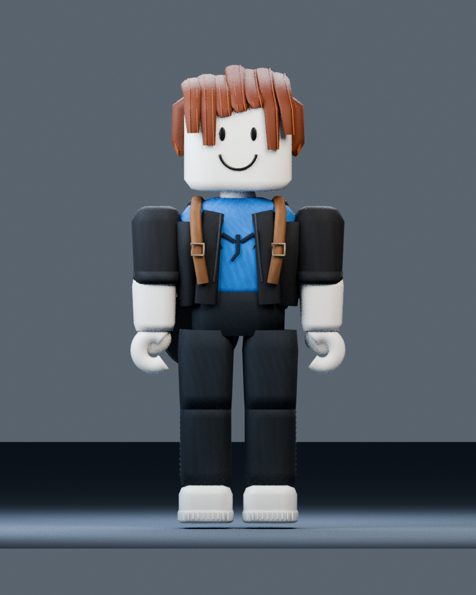
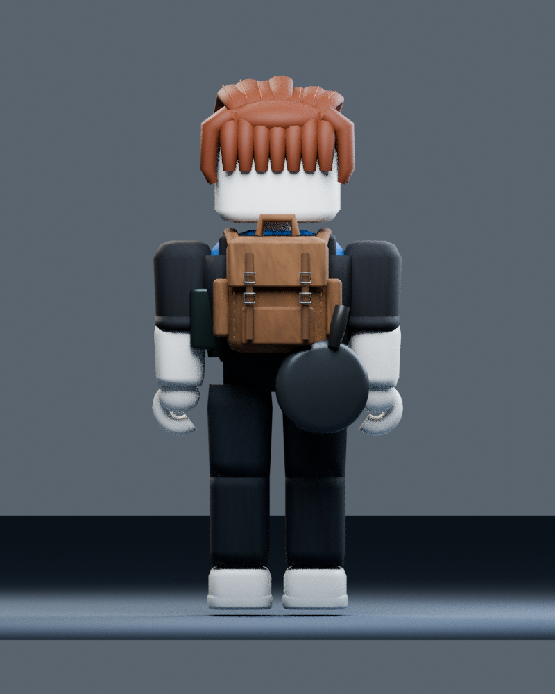

# Comprobación del FBX con texturas

Estas dos imágenes son **renders de Blender después de reimportar el FBX nuevo**. No son capturas de Roblox Studio. La geometría se comparó con la fuente anterior; las animaciones no se modificaron.

[Guía de importación e instalación](IMPORTAR.md). La comprobación visual en Roblox sigue pendiente.
