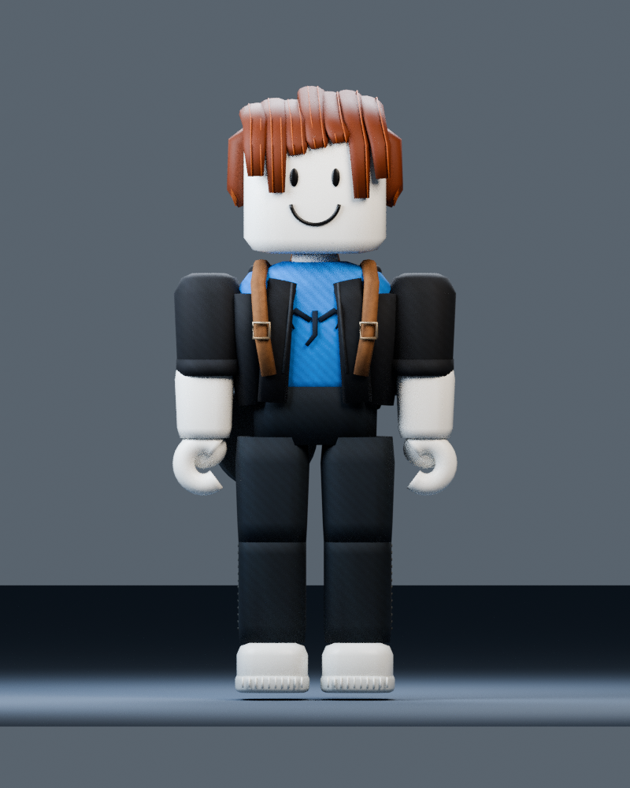
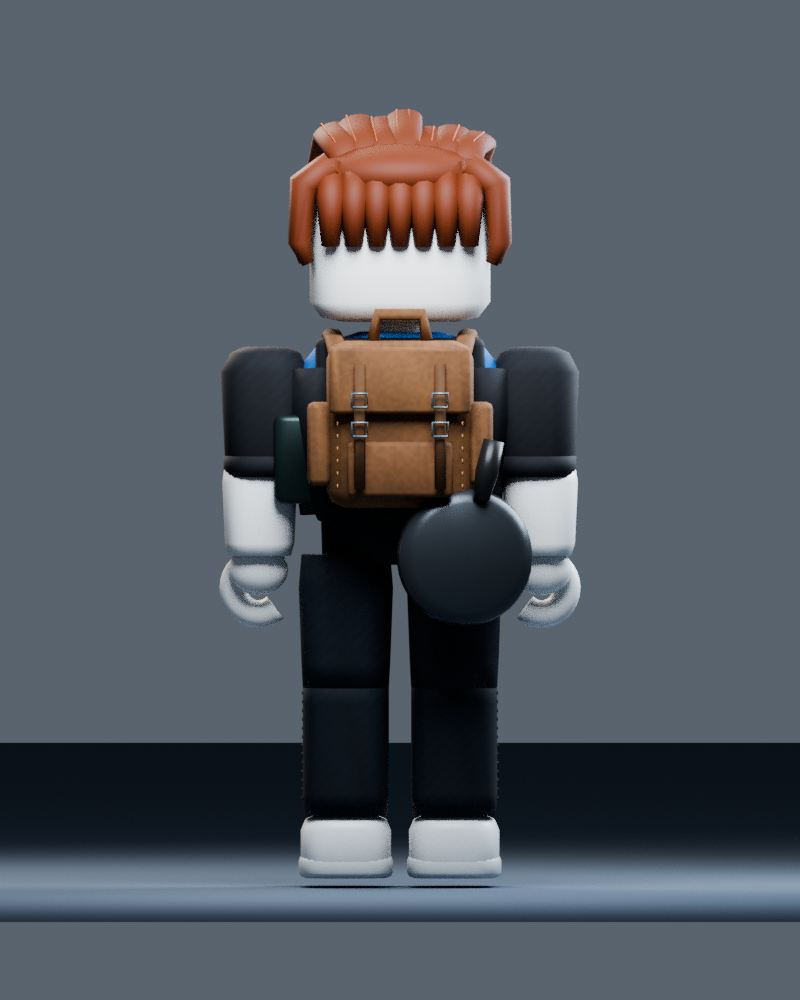
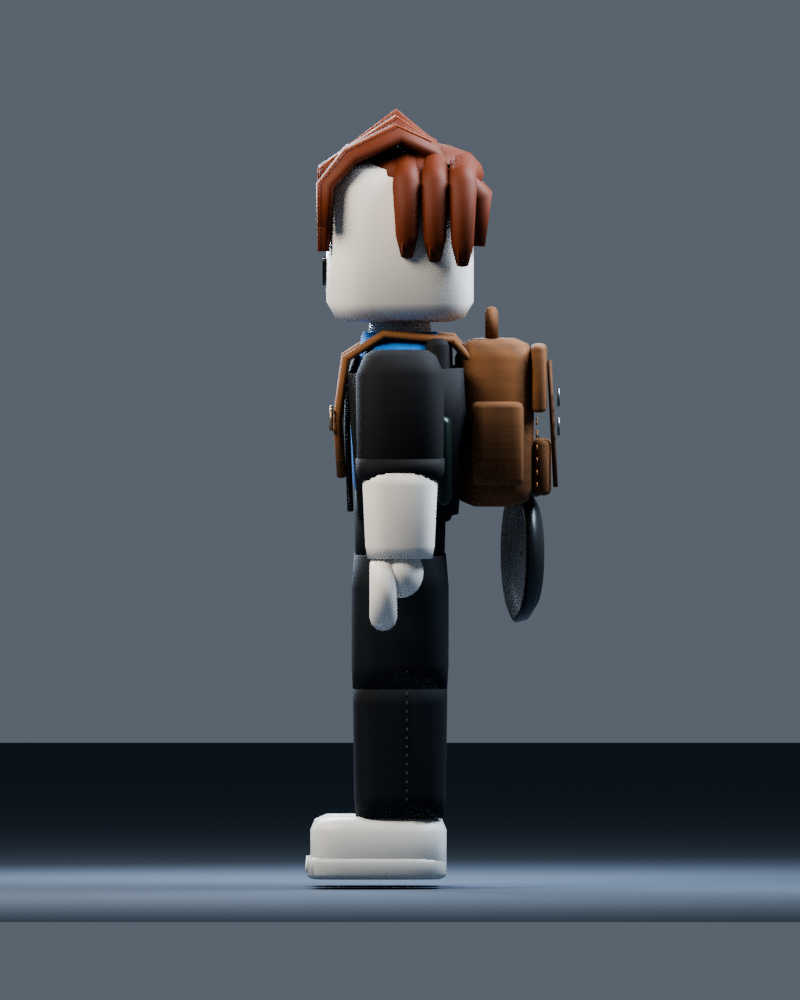
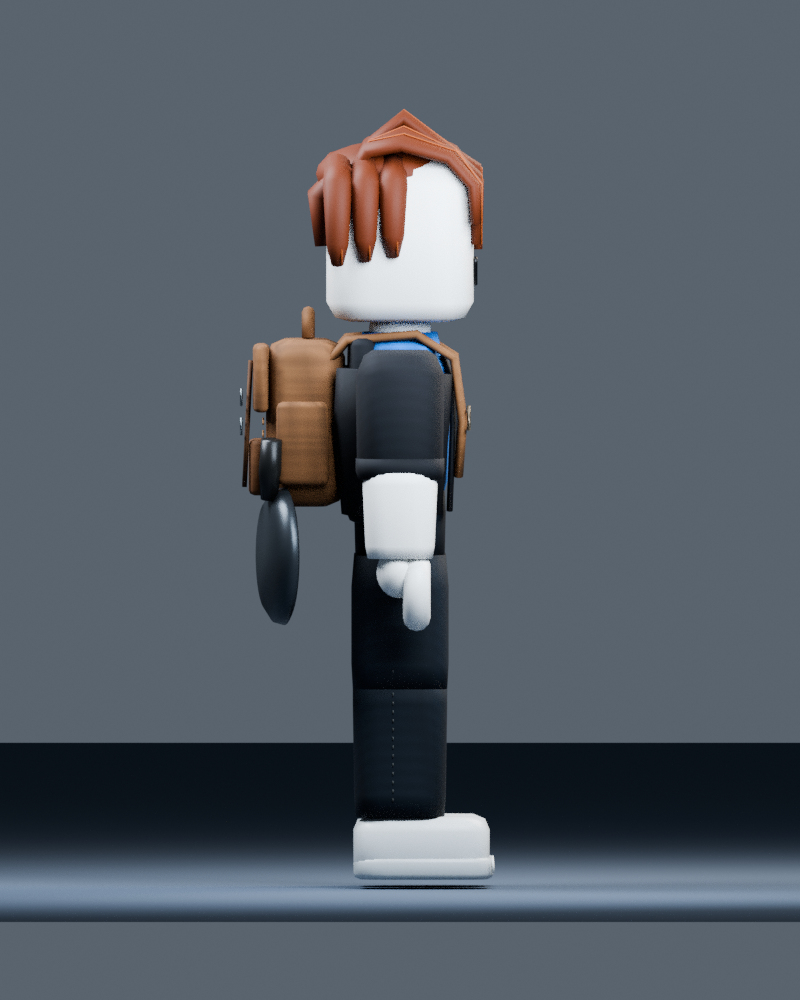
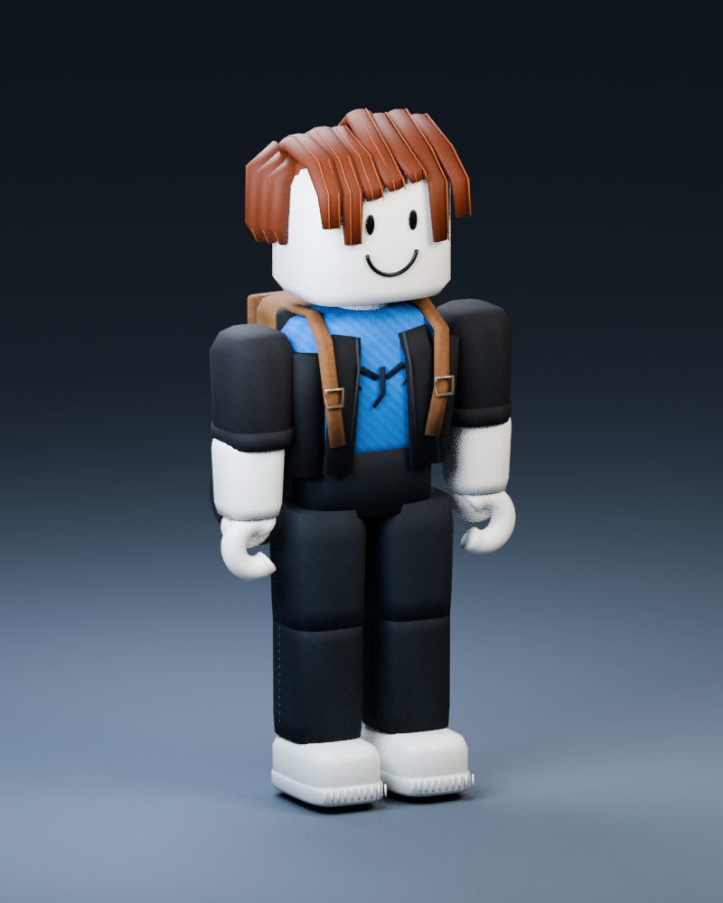

# Pelotocino: revisión visual

**Renders de Blender. No son capturas ni pruebas de Roblox Studio.** Las imágenes proceden de `assets/pelotocino/geometry.json`, los mismos datos de mallas que usa el controlador de Roblox. Blender difiere en iluminación y sombreado. No se certifica una réplica 1:1 de la referencia.

[Vídeo de animaciones en Blender](../../dist/pelotocino/Pelotocino-Animaciones-Blender.mp4). Reproduce muestras del controlador Luau: idle, caminar, correr, sartén, lanzamiento con raqueta, rastreador y daño. No simula impactos, networking ni física de Roblox. La trayectoria del mechón en este vídeo es una demostración visual; los impactos reales los valida el servidor en la prueba de juego.
